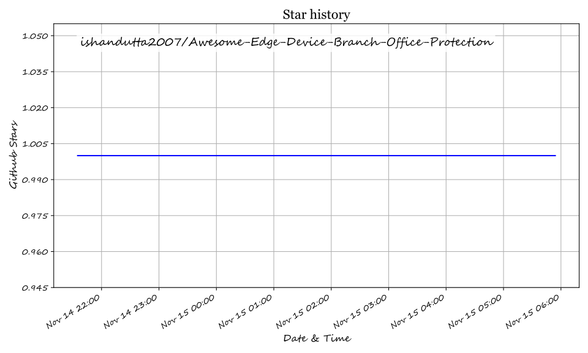

<p align="center">
  
</p>

# 🛡️ Awesome Edge Device & Branch Office Protection (ROBO) ⚡

<a href="https://github.com/ishandutta2007/Awesome-Awesome-Awesome"></a><a href="https://discord.gg/jc4xtF58Ve"></a>
[](https://github.com/ishandutta2007/Awesome-Awesome-Awesome)
[](LICENSE)
[](https://github.com/ishandutta2007/Awesome-Edge-Device-Branch-Office-Protection/pulls)
[](https://github.com/ishandutta2007/Awesome-Edge-Device-Branch-Office-Protection)
<a href="https://github.com/ishandutta2007"></a>

A curated collection of enterprise SaaS platforms, purpose-built appliances, open-source backup frameworks, and cyber-resilience tools designed for **Remote Office / Branch Office (ROBO)** data protection, **bare-metal endpoint recovery**, and **distributed edge computing resilience** 🚀.

---

## 📑 Table of Contents
- [📊 Sector Overview & Market Dynamics](#-sector-overview--market-dynamics)
- [🏢 Enterprise SaaS & Hybrid Cloud Platforms](#-enterprise-saas--hybrid-cloud-platforms)
- [🔓 Open-Source Projects & Frameworks](#-open-source-projects--frameworks)
- [🧭 Architecture & Selection Decision Guide](#-architecture--selection-decision-guide)
- [🤝 Contributing](#-contributing)
- [💖 Support & Sponsorship](#-support--sponsorship)
- [📈 Star History](#-star-history)
- [⚠️ Security & Operational Disclaimer](#️-security--operational-disclaimer)

---

## 📊 Sector Overview & Market Dynamics

The global data protection and disaster recovery software market is valued at approximately **$10.5 billion to $11.2 billion (2025/2026)** and is projected to exceed **$20.4 billion by 2030** (~13.8% CAGR), propelled by edge computing expansion and ransomware resilience imperatives 🌐. The sector exhibits a **barbell market structure**: it is **moderately concentrated at the enterprise core** where dominant vendors (Veeam, Commvault, Cohesity, Rubrik) capture majority enterprise IT budgets, yet **highly fragmented at the edge and ROBO tier** where decentralized requirements (unreliable WAN links, headless hardware, zero-trust remote retail sites, containerized IoT) necessitate specialized micro-appliances, MSP-managed BaaS, and lean open-source backup agents 🏗️.

---

## 🏢 Enterprise SaaS & Hybrid Cloud Platforms

The table below outlines enterprise SaaS and managed platforms tailored for ROBO and edge device protection, sorted in descending order by **Company Size (Valuation / Revenue Scale)** 💼.

| Product | Company Size (Valuation / Scale) | 💳 Pricing (Specific Starting Tiers) | 🎁 Free Tier / Trial Limits | 🎯 Primary Use Case & Architecture |
|---|---|---|---|---|
| **[Veeam Data Platform & Agent](https://www.veeam.com/)** | **$15.0B Valuation** (~$1.7B ARR) | **$10.00 to $15.00/workload/month** (sold as Veeam Universal License [VUL] bundles, list ~$120–$180/instance/yr, 5–10 pack minimums) | **Free Forever (Veeam Community Edition)**: Full functionality up to **10 workloads**; or **30-day full-feature trial** with unlimited instances | Bare-metal recovery to dissimilar hardware, Windows/Linux server & workstation image backups via centralized console. |
| **[Cohesity ROBO & DataProtect](https://www.cohesity.com/)** | **$7.5B Valuation** (~$1.6B Revenue post-Veritas deal) | **$2,425.00/month** (AWS Marketplace entry baseline for DataProtect as a Service: **$29,100/yr per 10 BETB block**; ~$80–$160/VM/yr custom quote) | **30-day free trial** with access to hosted SaaS DataProtect workflows and cloud replication sandbox | Consolidated ROBO appliance with global deduplication, immutability, and unified cloud tiering for remote branches. |
| **[Rubrik Security Cloud & Edge](https://www.rubrik.com/)** | **$6.2B Market Cap** (~$1.31B Revenue) | **$4,166.00/month** (Software-only subscription baselines start at **$50,000/yr** for mid-sized footprints; Rubrik SaaS M365 from ~$1.50–$4.00/user/mo) | **30-day free trial** (SaaS-hosted trial capped at **500 user accounts / 10 TB** protected data) | Zero-Trust Data Security platform featuring immutable air-gapped snapshots and ransomware blast-radius analysis. |
| **[Commvault Cloud & Edge Endpoint](https://www.commvault.com/)** | **$5.8B Market Cap** (~$995M Revenue) | **$8.16/VM/month** (Self-managed list price ~$98/VM/yr or ~$150/FETB/yr; Commvault SaaS File/Object from **$58.50/TB/month**) | **30-day free trial** across Commvault Cloud workloads (full enterprise management console access, no credit card required) | Comprehensive policy-driven edge laptop, desktop, and branch server backup integrated into enterprise catalogs. |
| **[Acronis Cyber Protect Cloud](https://www.acronis.com/)** | **$3.5B Valuation** (~$420M Revenue) | **$15.00/workload/month** (MSP/Channel starting tier per server/VM workload; Advanced backup bundles start at ~$25–$35/workload/mo) | **30-day free trial** with complete features enabled (reverts to restore-only mode upon trial expiration) | Integrated cybersecurity, patch management, EDR, and full image disaster recovery optimized for MSP remote management. |
| **[Druva Data Resiliency Cloud](https://www.druva.com/)** | **$2.0B Valuation** (~$220M ARR) | **$8.00/user/month** (Starting tier for endpoint data protection; Enterprise ROBO servers priced at **$210.00/TB/month** deduplicated storage) | **30-day free trial** (Includes up to 100 endpoints or 1 TB backup quota, extendable up to 60 days via support) | 100% serverless SaaS backup with no edge hardware footprint, automated deduplication, and direct-to-cloud sync. |

---

## 🔓 Open-Source Projects & Frameworks

Production-grade open-source backup agents, image-level recovery frameworks, and edge orchestrators. Ranked in descending order by **GitHub Stars_Count** ⭐.

| Project | GitHub_Stars_Badge | 🛠️ Description & ROBO Strengths | ⚠️ Key Constraints & Trade-offs |
|---|---|---|---|
| **[Syncthing](https://github.com/syncthing/syncthing)** | [](https://github.com/syncthing/syncthing/stargazers) | **Continuous peer-to-peer decentralized file synchronization.** Highly resilient for branch offices and distributed field systems. Encrypted in transit with TLS and perfect forward secrecy, syncing files across LANs and WANs without central cloud servers. | File synchronization tool, not a block-level or bare-metal recovery engine; requires separate version retention management. |
| **[Rclone](https://github.com/rclone/rclone)** | [](https://github.com/rclone/rclone/stargazers) | **The Swiss Army knife of cloud storage sync.** Supports 70+ backend providers (S3, B2, Azure Blob, SFTP, WebDAV). Offers built-in client-side encryption (`crypt`), bandwidth throttling, and chunked uploads tailored for slow WAN branch links. | CLI-driven; does not manage snapshot catalogs or incremental differential blocks natively without external scripts. |
| **[Restic](https://github.com/restic/restic)** | [](https://github.com/restic/restic/stargazers) | **Fast, secure, authenticated snapshot backup program.** Single self-contained Go binary with cryptographic integrity (AES-256 in CTR mode, Poly1305-AES). Directly writes deduplicated snapshots to S3, Backblaze B2, SFTP, and local disks. | Headless CLI only; no native scheduler or web console. Requires external systemd timers or cron orchestration across branches. |
| **[K3s](https://github.com/k3s-io/k3s)** | [](https://github.com/k3s-io/k3s/stargazers) | **Lightweight certified Kubernetes distribution (<100MB binary) built for IoT and edge.** Package includes sqlite/embedded etcd snapshotting. Perfect for orchestrating containerized microservices and automated volume snapshot backups across branch clusters. | Edge container platform rather than a backup agent; pair with Velero or Restic for full stateful application backup. |
| **[Duplicati](https://github.com/duplicati/duplicati)** | [](https://github.com/duplicati/duplicati/stargazers) | **Cross-platform block-level backup client with built-in web management interface.** Runs on Windows, Linux, and macOS. Features AES-256 encryption, content-based chunk deduplication, bandwidth limits, and scheduled cloud offloading. | SQLite local database repairs can be slow on very large backup sets (>1 TB); critical restores must be tested regularly. |
| **[Kopia](https://github.com/kopia/kopia)** | [](https://github.com/kopia/kopia/stargazers) | **Fast and secure backup engine with desktop GUI, web interface, and CLI.** Written in Go. Features zero-knowledge encryption, deduplication, content-addressable storage, and an optional centralized repository server mode for multi-device management. | Server mode requires network access to the primary repository or TLS-secured HTTP proxying for edge clients. |
| **[BorgBackup](https://github.com/borgbackup/borg)** | [](https://github.com/borgbackup/borg/stargazers) | **Deduplicating backup archiver with authenticated encryption.** Renowned for chunk-level deduplication efficiency on Linux hosts. Supports append-only repository modes to prevent compromised branch devices from destroying past backups. | Native transport is SSH/local filesystem only (no native S3 API support; requires SSH targets or mounted remote storage). |
| **[KubeEdge](https://github.com/kubeedge/kubeedge)** | [](https://github.com/kubeedge/kubeedge/stargazers) | **CNCF-graduated edge computing platform extending Kubernetes to remote branch nodes.** Provides EdgeCore runtime (~30MB footprint) with bidirectional cloud-edge sync and local autonomous operation during WAN disconnects. | Orchestration layer; requires companion storage snapshotters or CSI backup plugins to safeguard persistent state. |
| **[borgmatic](https://github.com/borgmatic-collective/borgmatic)** | [](https://github.com/borgmatic-collective/borgmatic/stargazers) | **Declarative automation wrapper for BorgBackup.** Unifies retention policies, snapshot schedules, consistency checks, database dumps (PostgreSQL, MySQL, SQLite), and health check monitoring into human-readable YAML configs. | Dependent on BorgBackup runtime and SSH destination infrastructure; designed specifically for Linux branch environments. |
| **[Bareos](https://github.com/bareos/bareos)** | [](https://github.com/bareos/bareos/stargazers) | **Enterprise client/server backup architecture with centralized catalog.** Mature fork of Bacula (AGPLv3) supporting disk, tape libraries, and S3 object targets with client encryption, TLS transport, and WORM storage support. | Complex multi-daemon setup (Director, Storage Daemon, File Daemon); requires dedicated administrative overhead. |
| **[UrBackup](https://github.com/uroni/urbackup_backend)** | [](https://github.com/uroni/urbackup_backend/stargazers) | **Client/server backup system offering both file backups and raw whole-disk image backups.** Supports VSS-based live snapshots on Windows and dattobd/LVM on Linux. Delivers true bare-metal recovery via bootable ISO/USB for branch hardware failures. | Optimal storage deduplication requires a btrfs or ZFS filesystem on the backup server; ext4 relies on hardlinks. |

---

## 🧭 Architecture & Selection Decision Guide

```
                           What is your primary branch requirement?
                                              │
         ┌────────────────────────────────────┼────────────────────────────────────┐
         │                                    │                                    │
         ▼                                    ▼                                    ▼
┌──────────────────┐                ┌──────────────────┐                ┌──────────────────┐
│ Bare-Metal Image │                │  File / Database │                │ Edge Application │
│   Restoration    │                │ Deduplication    │                │  Microservices   │
└────────┬─────────┘                └────────┬─────────┘                └────────┬─────────┘
         │                                   │                                   │
   ┌─────┴─────┐                       ┌─────┴─────┐                       ┌─────┴─────┐
   ▼           ▼                       ▼           ▼                       ▼           ▼
[Veeam /   [UrBackup]              [Druva /    [Restic /               [K3s /      [Bareos]
 Acronis]  (Open-Source)           Commvault]   Kopia]                 KubeEdge]   (Enterprise)
```

1. **🏬 For Remote Retail / Branch POS with No On-Site IT:**
   - Choose **Veeam Agent** or **Acronis Cyber Protect** if budget permits turnkey SaaS management.
   - Choose **UrBackup** for an open-source, license-free alternative that can restore a fried branch cash register or workstation to different bare-metal hardware via bootable media.
2. **🐧 For Lightweight Linux Edge Servers & IoT Gateways:**
   - Deploy **Restic** or **Kopia** with systemd timers pushing encrypted chunks to object storage (AWS S3, Wasabi, or MinIO).
   - Use **borgmatic** if automated database dumps (PostgreSQL/MySQL) and append-only SSH targets are required for ransomware defense.
3. **🛰️ For Bandwidth-Constrained Satellite WAN Links:**
   - Use **Rclone** with `--bwlimit` parameters or **Syncthing** for delta-only branch replication without saturating mission-critical VoIP or POS traffic.

---

## 🤝 Contributing

Contributions are warmly welcomed! 🌟 Please review the guidelines below:
1. Ensure the product or project directly solves **Edge Device**, **ROBO (Remote Office/Branch Office)**, or **Distributed Endpoint** backup/recovery challenges.
2. For SaaS tools: include starting prices and specific free trial terms.
3. For Open-Source projects: provide the GitHub repository link, Stars_Count badge, and objective trade-off analysis.
4. Follow the existing Markdown table formats and submit a pull request!

---

## 💖 Support & Sponsorship

If you find this curated ecosystem helpful, please consider supporting the project! Your encouragement keeps this list updated, accurate, and battle-tested for systems engineers worldwide. 🌍

- ⭐ **Star this repository** to help others discover it.
- 🍴 **Fork and contribute** your production setups, architectures, or new tools.
- 📢 **Share** with colleagues and dev communities.
- ☕ **Buy a coffee / Become a sponsor**: Support ongoing maintenance on the [GitHub Sponsors Dashboard](https://github.com/sponsors/ishandutta2007).

---

## 📈 Star History

[](https://www.star-history.com/#ishandutta2007/Awesome-Edge-Device-Branch-Office-Protection&type=date&legend=top-left)

---

## ⚠️ Security & Operational Disclaimer

- 🔐 Edge backup repositories must be secured with **append-only permissions** or **immutable WORM object locks** to prevent threat actors from purging snapshots if branch credentials are compromised.
- 🧪 Regularly perform physical bare-metal recovery drills on branch hardware: restoring individual files does not guarantee that full OS disk images will boot on dissimilar motherboards or storage controllers.

---

<p align="center">
  <b>Curated with care for IT administrators, Systems Engineers, and Edge DevOps Teams worldwide.</b>
</p>

## ⭐ Star History

<a href="https://star-history.com/#ishandutta2007/Awesome-Edge-Device-Branch-Office-Protection&Timeline" align="center">
  <picture>
    <source media="(prefers-color-scheme: dark)" srcset="assets/ishandutta2007_Awesome-Edge-Device-Branch-Office-Protection_growth.svg">
    
  </picture>
</a>
